<p align="center">
  
</p>

<h1 align="center">Adult Aristocrat</h1>

<p align="center">
  <b>Нативный клиент для личного кинотеатра на базе <a href="https://jellyfin.org">Jellyfin</a></b><br>
  Android · Android TV · Windows 7 / 10 / 11 · Linux
</p>

<p align="center">
  
  
  
</p>

<p align="center">
  
  
  
  
</p>

---

> [!WARNING]
> **Только для взрослых (18+).** Приложение создано для частного медиасервера с контентом для взрослых.
> На всех скриншотах ниже обложки, фото актёров и кадры **размыты**.

> [!NOTE]
> **Это исходный код, а не готовый продукт.** В этом репозитории нет файлов для скачивания:
> приложение собрано под конкретный личный сервер Jellyfin.
> Если у вас свой Jellyfin — соберите приложение под него сами, см. раздел
> **[Для разработчиков](#-для-разработчиков)**.

---

## 📖 О проекте

**Adult Aristocrat** — это «свой Netflix» для домашнего сервера Jellyfin. Вместо универсального клиента
со списком серверов и настройками — приложение, которое выглядит как отдельный онлайн-кинотеатр:

- 🔒 **привязано к одному серверу** — у зрителя только логин и пароль, никаких адресов;
- 🎨 **собственный стиль** — красно-чёрная тема в духе Netflix, логотип и шрифты кинотеатра;
- 📱📺💻 **один код — все экраны**: телефон, планшет, телевизор с пультом, компьютер с мышью;
- 🎞️ **заточено под фильмы со сценами** — главы MKV показываются как «Сцены» с превью и переходом в один клик;
- 📶 **работает и без сервера** — офлайн-библиотека из сетевых папок дома (NAS, SMB).

---

## 🖼️ Скриншоты

### 💻 Компьютер (Windows / Linux)

<table>
  <tr>
    <td width="50%">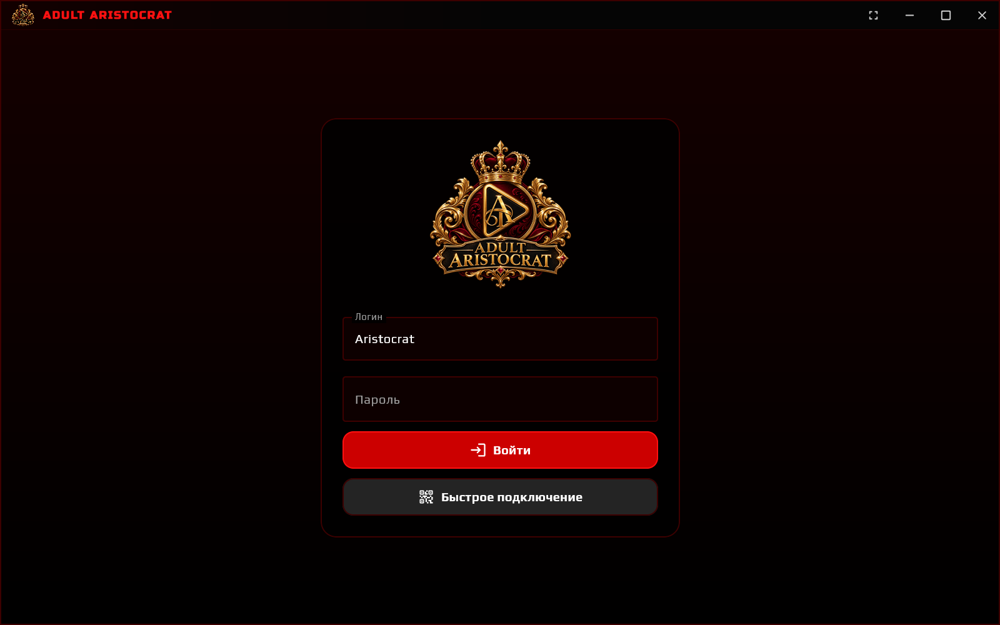<p align="center"><sub>Вход: логин и пароль или «Быстрое подключение»</sub></p></td>
    <td width="50%"><p align="center"><sub>Главная: новинки, студии, страна и год на карточке</sub></p></td>
  </tr>
  <tr>
    <td>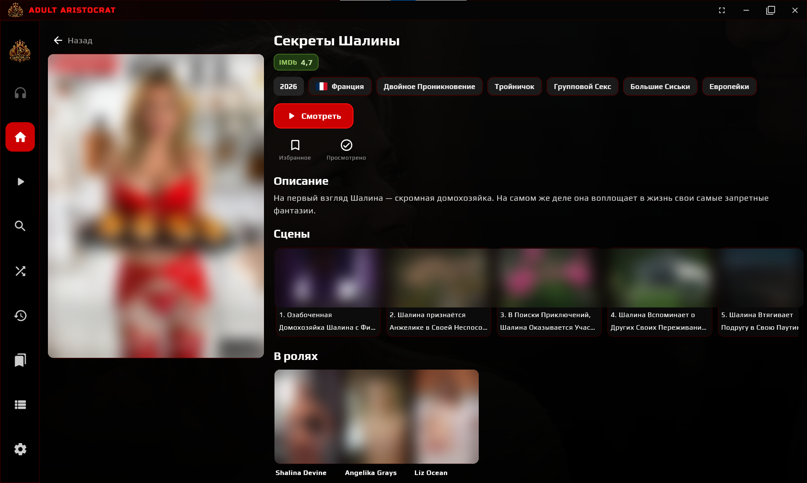<p align="center"><sub>Страница фильма: рейтинг, жанры, сцены, актёры</sub></p></td>
    <td>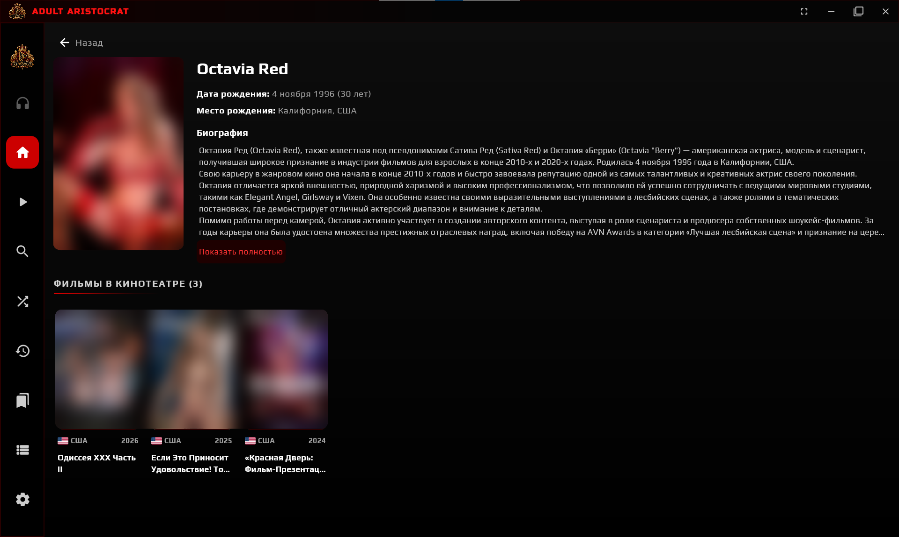<p align="center"><sub>Страница актрисы: биография и все её фильмы</sub></p></td>
  </tr>
  <tr>
    <td>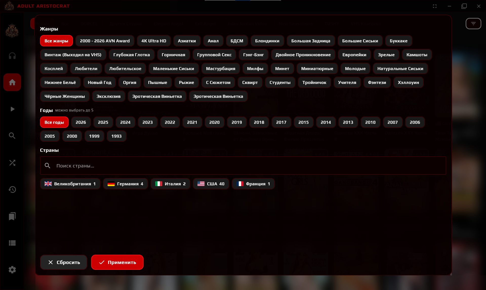<p align="center"><sub>Фильтр: только реально существующие жанры, годы и страны</sub></p></td>
    <td>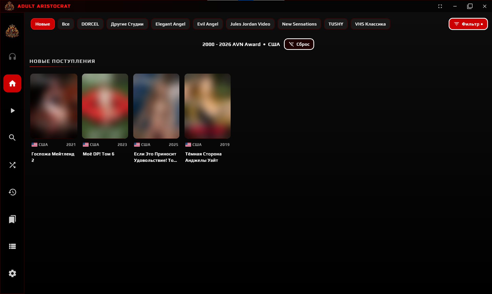<p align="center"><sub>Результат фильтра и кнопка «Сброс»</sub></p></td>
  </tr>
  <tr>
    <td>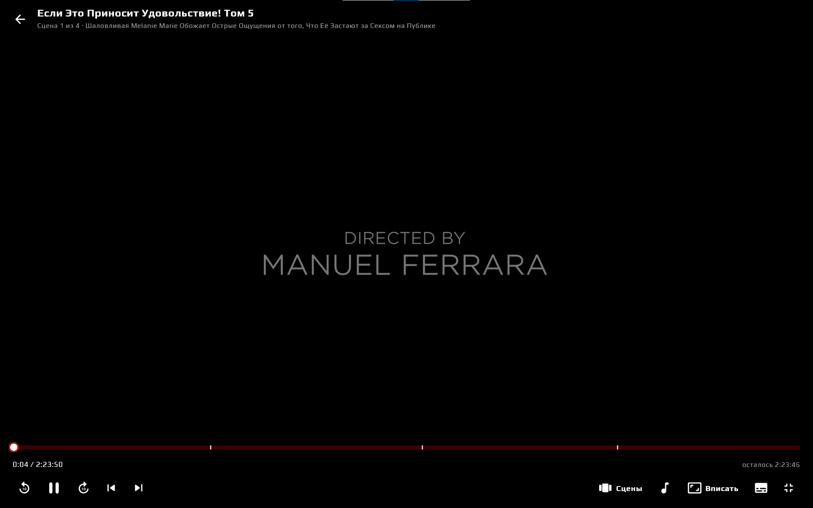<p align="center"><sub>Плеер: метки сцен на шкале, озвучка, субтитры, режим картинки</sub></p></td>
    <td>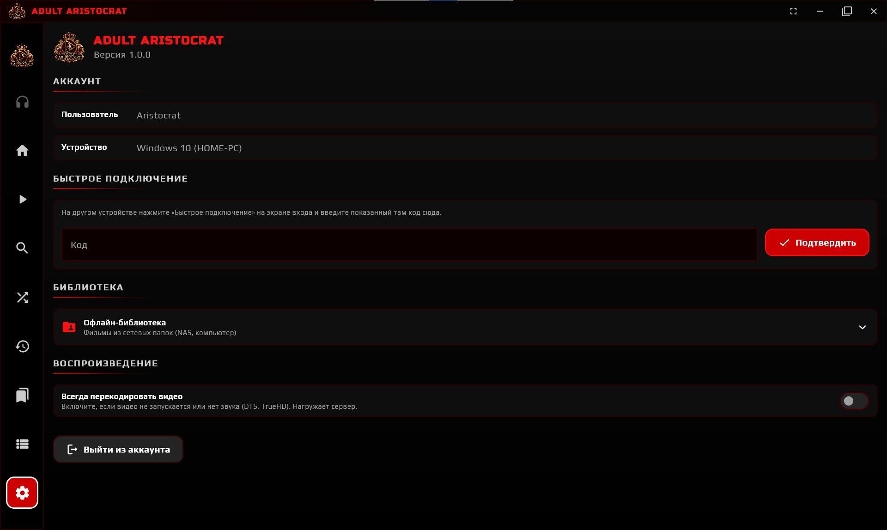<p align="center"><sub>Настройки: аккаунт, Quick Connect, офлайн-библиотека</sub></p></td>
  </tr>
</table>

### 📱 Телефон и планшет (Android)

<table>
  <tr>
    <td width="25%">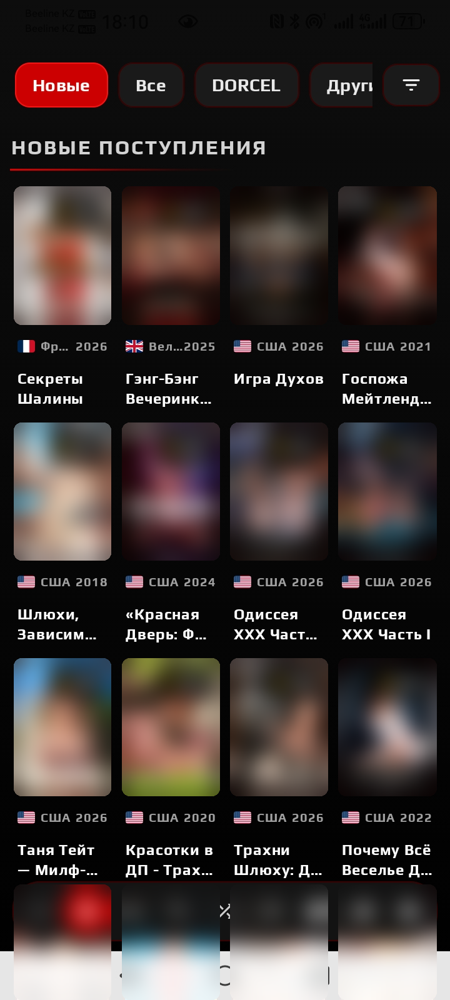</td>
    <td width="25%">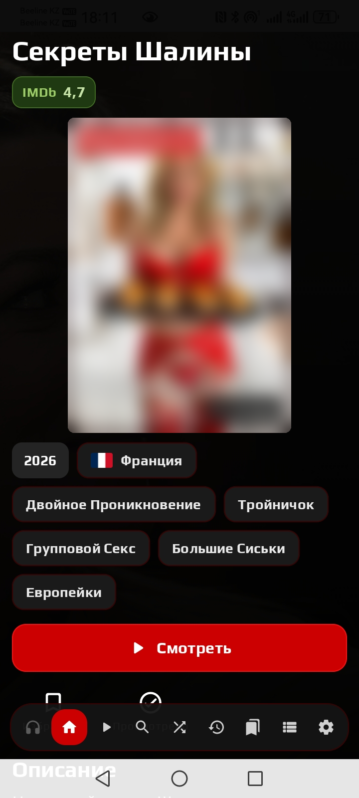</td>
    <td width="25%">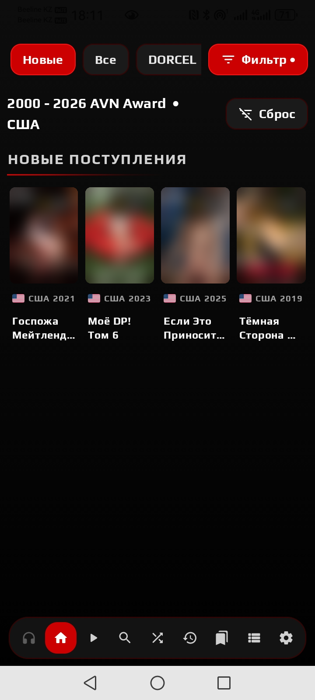</td>
    <td width="25%">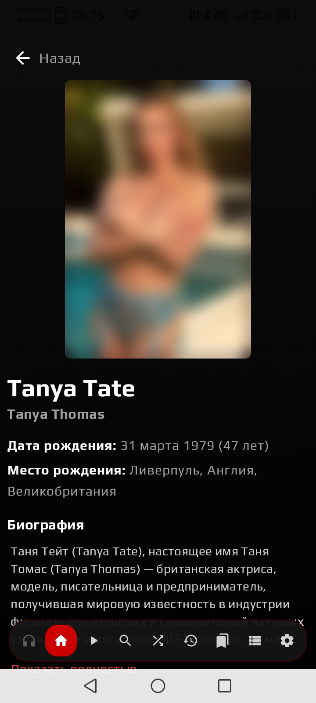</td>
  </tr>
  <tr>
    <td align="center"><sub>Главная</sub></td>
    <td align="center"><sub>Фильм</sub></td>
    <td align="center"><sub>Фильтр + «Сброс»</sub></td>
    <td align="center"><sub>Актриса</sub></td>
  </tr>
</table>

<p align="center">
  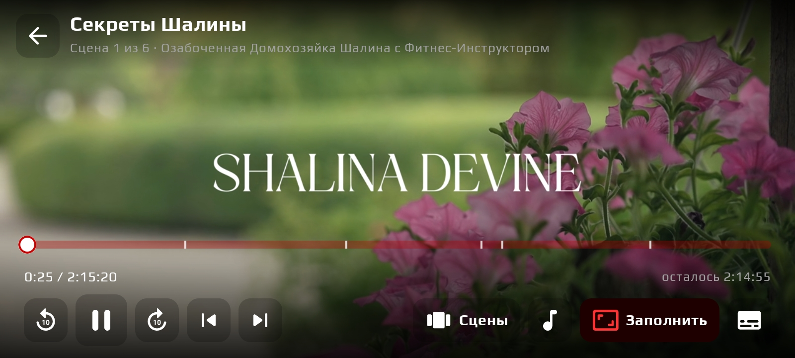<br>
  <sub>Плеер на телефоне: жесты как в VLC — двойное нажатие слева/справа перематывает на 10 секунд</sub>
</p>

### 📺 Телевизор (Android TV)

<table>
  <tr>
    <td width="33%">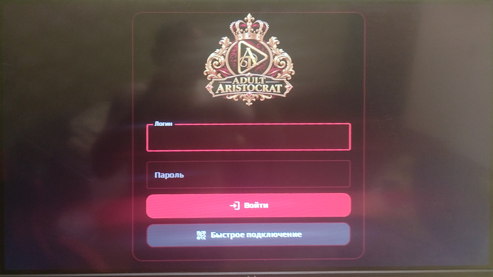</td>
    <td width="33%">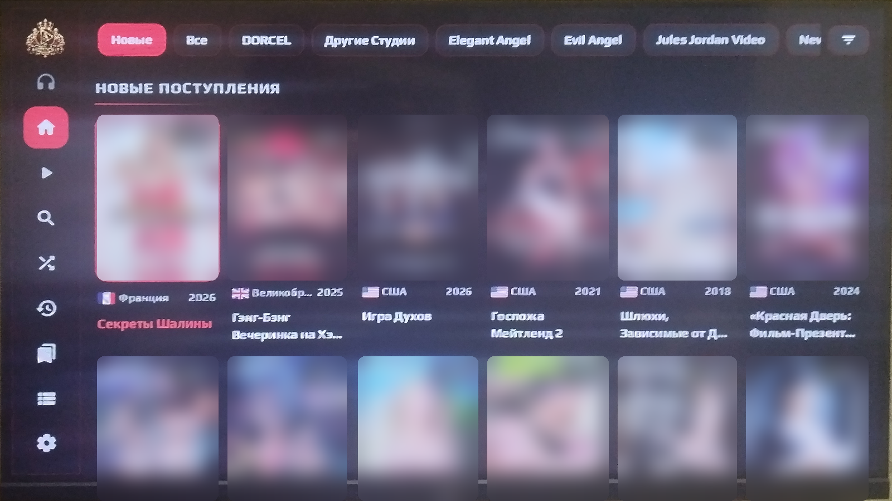</td>
    <td width="33%"></td>
  </tr>
  <tr>
    <td align="center"><sub>Вход — без набора пароля пультом через Quick Connect</sub></td>
    <td align="center"><sub>Главная: боковое меню, управление стрелками</sub></td>
    <td align="center"><sub>Фильм: «Продолжить с…» и «С начала»</sub></td>
  </tr>
</table>

---

## ✨ Возможности

| | Функция | Описание |
|---|---|---|
| 🏠 | **Каталог** | Новые поступления, все фильмы, разделы-студии, подборки, случайный фильм |
| 🔎 | **Поиск и фильтры** | Поиск по названию; фильтр по жанрам, годам и странам — в списках только то, что есть на сервере; кнопка «Сброс» |
| 🎞️ | **Страница фильма** | Обложка целиком, рейтинги, страна с флагом, жанры, описание, сцены, актёры. Нажмите на страну или жанр — откроются все такие фильмы |
| 👤 | **Актёры и режиссёры** | Фото, дата и место рождения, биография, все фильмы в кинотеатре |
| 🎬 | **Сцены** | Главы MKV — превью и переход в один клик, со страницы фильма и прямо из плеера |
| 🖥️ | **Режимы картинки** | Вписать / Заполнить / Растянуть — убирают чёрные полосы, как в VLC |
| ⏯️ | **Продолжить просмотр** | Кнопка ▶ в меню сразу продолжает последний недосмотренный фильм |
| 🕘 | **История** | Начатые и досмотренные фильмы, очистка одной кнопкой |
| ⭐ | **Избранное** | Добавление со страницы фильма; удаление долгим нажатием / удержанием OK / правой кнопкой мыши |
| 🎧 | **Наушники** | Кнопка над «Главной» включает и выключает Bluetooth-наушники; зелёная — подключены |
| 🔇 | **Тишина вокруг** | При запуске фильма музыка и видео в других приложениях ставятся на паузу |
| 🔐 | **Свои аккаунты** | Вход логином Jellyfin или по коду Quick Connect; у каждого зрителя своя история |
| 📶 | **Офлайн-библиотека** | Фильмы из сетевых папок (SMB/NAS) в формате Kodi: `.nfo`, постеры, фото актёров, сцены из MKV |
| 🔁 | **Авто онлайн ⇄ офлайн** | Пропала связь с сервером — приложение само переходит на офлайн-библиотеку и обратно |
| 🪟 | **Окно без рамки** | На ПК — своя шапка в стиле кинотеатра, открывается развёрнутым, F11 — во весь экран |

---

## 💿 Поддерживаемые системы

| Система | Версия | Формат сборки | Плеер |
|---|---|---|---|
| 📱 **Android** — телефоны, планшеты | 5.0 и новее | `.apk` | ExoPlayer (Media3) |
| 📺 **Android TV**, ТВ-приставки | 5.0 и новее | тот же `.apk`, свой интерфейс под пульт | ExoPlayer (Media3) |
| 🪟 **Windows 10 / 11** | x64 | установщик Inno Setup (RU / EN) | VLC 3 — встроен |
| 🪟 **Windows 7 SP1 / 8.1** | x64 | отдельный установщик + portable `.zip` | VLC 3 — встроен |
| 🐧 **Linux** — Ubuntu, Debian, Mint | x64 | `.deb` | VLC 3 из системы |
| 🐧 **Linux** — Fedora, openSUSE | x64 | `.rpm` | VLC 3 из системы |
| 🐧 **Linux** — любой дистрибутив | x64 | `.tar.gz` | VLC 3 из системы |

> На Linux для видео нужен VLC: `sudo apt install vlc` или `sudo dnf install vlc`.

---

## 🎮 Управление

### ⌨️ Клавиатура и мышь (Windows, Linux)

| Действие | Клавиша |
|---|---|
| Пауза / продолжить | <kbd>Пробел</kbd> или <kbd>K</kbd>, щелчок по видео |
| Перемотка ±10 сек | <kbd>←</kbd> <kbd>→</kbd> |
| Предыдущая / следующая сцена | <kbd>PgUp</kbd> <kbd>PgDn</kbd> или <kbd>P</kbd> <kbd>N</kbd> |
| Режим картинки | <kbd>Z</kbd> |
| Во весь экран | <kbd>F11</kbd> или <kbd>F</kbd>, двойной щелчок по видео |
| Выйти из плеера / из полноэкранного режима | <kbd>Esc</kbd> |
| Удалить из избранного | правая кнопка мыши на карточке |
| Развернуть окно | двойной щелчок по шапке окна |

### 📺 Пульт (Android TV)

| Действие | Кнопка |
|---|---|
| Навигация | ▲ ▼ ◀ ▶ |
| Выбрать / пауза | <kbd>OK</kbd>, ⏯ |
| Перемотка ±10 сек | ◀ ▶ (когда панель плеера скрыта) |
| Перемотка ±30 сек | ⏪ ⏩ |
| Предыдущая / следующая сцена | ⏮ ⏭, <kbd>CH−</kbd> <kbd>CH+</kbd> |
| Список сцен | <kbd>Menu</kbd>, <kbd>Info</kbd>, 🔴 красная |
| Звуковая дорожка | 🟢 зелёная |
| Субтитры | 🟡 жёлтая |
| Режим картинки | 🔵 синяя |
| Остановить и выйти (позиция сохранится) | ⏹, «Назад» |
| Открыть клавиатуру в поле ввода | <kbd>OK</kbd> на поле |
| Удалить из избранного | удерживать <kbd>OK</kbd> на карточке |

### 👆 Жесты (телефоны и планшеты)

| Жест | Действие |
|---|---|
| Одно нажатие по видео | Показать / скрыть кнопки |
| Двойное нажатие справа | +10 сек (каждое следующее быстрое нажатие — ещё +10) |
| Двойное нажатие слева | −10 сек (так же) |
| Двойное нажатие и удержание справа / слева | Перемотка вперёд / назад, пока держите палец |
| Двойное нажатие по центру | Пауза / продолжить |
| Долгое нажатие на карточку в «Избранном» | Удалить из избранного |

---

## 📶 Офлайн-библиотека

Если дома есть сетевая папка или NAS с фильмами, приложение показывает их даже без связи с сервером.

1. **Настройки → Офлайн-библиотека** → включите переключатель.
2. Нажмите **«Найти в сети»** или введите IP-адрес компьютера / NAS.
3. Добавьте папки с фильмами и нажмите **«Сканировать папки»**.

Поддерживается структура, как у Kodi:

```
Фильм (2024)/
├── Фильм (2024).mkv      ← сцены берутся из глав MKV
├── movie.nfo             ← название, описание, жанры, страна, актёры
├── poster.jpg
├── fanart.jpg
└── .actors/
    └── Имя_Актрисы.jpg
```

---

## 🛠 Для разработчиков

### Технологии

| | |
|---|---|
| Язык | **Kotlin 2.1** |
| Интерфейс | **Compose Multiplatform 1.8** — общий для Android и ПК |
| Сеть | Ktor 3 (OkHttp), kotlinx.serialization |
| Картинки | Coil 3 |
| Плеер Android | AndroidX Media3 / ExoPlayer (прямое воспроизведение, remux HLS, перекодирование) |
| Плеер ПК | VLC 3 через vlcj (кадры рисуются прямо в Compose) |
| Офлайн / SMB | jcifs-ng + встроенный HTTP-сервер с поддержкой Range |
| Сборка | Gradle 8.11, AGP 8.7, JDK 17, GitHub Actions, Inno Setup 6.2.2 |

### Структура

```
composeApp/src/
├── commonMain/      ← общий код: API Jellyfin, экраны, тема, плеер-оверлей
│   └── kotlin/com/adultaristocrat/cinema/
│       ├── AppConfig.kt      ← ⚙️ адрес сервера, название, типы контента
│       ├── api/              ← клиент Jellyfin REST
│       ├── offline/          ← офлайн-библиотека
│       └── ui/               ← экраны и компоненты
├── jvmShared/       ← общий JVM-код для Android и ПК (SMB, NFO, главы MKV)
├── androidMain/     ← ExoPlayer, Bluetooth, иконки, манифест
└── desktopMain/     ← окно без рамки, VLC, Windows / Linux
packaging/           ← установщики Windows (Inno Setup), файлы для Win7
.github/workflows/   ← сборка всех платформ в GitHub Actions
```

### 🔌 Подключение своего сервера Jellyfin

Всё, что нужно поменять, лежит в одном файле:
**`composeApp/src/commonMain/kotlin/com/adultaristocrat/cinema/AppConfig.kt`**

```kotlin
object AppConfig {
    const val APP_NAME = "Adult Aristocrat"

    // ⬇️ Адрес ВАШЕГО Jellyfin — с портом, без слэша в конце
    const val SERVER_URL = "https://jellyfin.example.com"
    // или в локальной сети: "http://192.168.1.10:8096"

    // Какие элементы показывать (только фильмы)
    const val CONTENT_TYPES = "Movie"
    const val PLAYABLE_TYPES = "Movie"
    const val SHOW_SERIES = false
}
```

| Значение `SERVER_URL` | Что увидит пользователь |
|---|---|
| `"https://jellyfin.example.com"` | Только логин и пароль — приложение «намертво» привязано к серверу |
| `""` (пустая строка) | На экране входа появится поле «Адрес сервера» — удобно для отладки |

> [!IMPORTANT]
> **Никогда не вписывайте в код API-ключ Jellyfin.** Ключ даёт права администратора, а из APK
> или EXE его легко достать. Каждый зритель входит своим логином Jellyfin или через Quick Connect.

**На сервере Jellyfin** (Панель управления):

- 👥 **Пользователи** — создайте аккаунт каждому зрителю;
- 📲 **Общие → Быстрое подключение** — включите, чтобы входить по коду (удобно на ТВ);
- 🎬 **Библиотека фильмов → Извлекать изображения глав** — тогда у сцен будут превью;
- 🌐 **Сеть** — если сервер доступен из интернета, лучше открыть его по **https** (обратный прокси).
  Обычный `http` тоже работает: в Android-версии он разрешён в `network_security_config.xml`.

### 🎨 Свой бренд (по желанию)

| Что | Где |
|---|---|
| Название | `AppConfig.APP_NAME`, `composeApp/build.gradle.kts` (`packageName`, `description`), `packaging/windows/AdultAristocrat.iss` |
| ID приложения Android | `applicationId` в `composeApp/build.gradle.kts` |
| Логотип внутри приложения | `androidMain/res/drawable-nodpi/app_logo.png`, `desktopMain/resources/app_logo.png` |
| Иконки | `composeApp/icons/` (ПК), `androidMain/res/mipmap-*` (Android), `drawable-xhdpi/tv_banner.png` (Android TV) |
| Цвета | `ui/Theme.kt` (объект `AA`) |
| Картинки установщика | `packaging/windows/wizard*.bmp`, `setup.ico` |
| GUID установщика | `AppId` в `.iss` и `upgradeUuid` в `build.gradle.kts` — сгенерируйте свой |

> [!CAUTION]
> **Ключ подписи Android.** В `composeApp/keystore/release.jks` лежит тестовый ключ с паролями
> в `build.gradle.kts`. Для своей сборки создайте собственный ключ:
> ```bash
> keytool -genkeypair -v -keystore composeApp/keystore/release.jks -alias aa \
>   -keyalg RSA -keysize 2048 -validity 10000
> ```
> и поменяйте пароли в блоке `signingConfigs`. Пароли лучше хранить в секретах GitHub, а не в коде.

### 🏗 Сборка

**Через GitHub Actions (ничего не нужно ставить):** сделайте форк или загрузите код в свой
репозиторий — сборка запустится сама после push. Готовые файлы появятся во вкладке
**Actions → запуск → Artifacts** (`android-apk`, `windows`, `linux`).
Тег вида `v1.2.3` создаёт релиз с этими файлами.

**Локально** (нужен JDK 17; для Android — Android SDK):

```bash
# шрифты интерфейса (один раз)
bash scripts/fetch-assets.sh

# Android / Android TV → composeApp/build/outputs/apk/release/
./gradlew :composeApp:assembleRelease

# Запуск на ПК без установки (нужен VLC 3 x64)
./gradlew :composeApp:run

# Linux-пакеты → composeApp/build/compose/binaries/main/{deb,rpm}/
./gradlew :composeApp:packageDeb :composeApp:packageRpm

# Windows: программа + встроенный VLC, затем установщики Inno Setup
bash scripts/fetch-vlc-windows.sh
./gradlew :composeApp:createDistributable
iscc -DMyAppVersion=1.0.0 packaging/windows/AdultAristocrat.iss         # Windows 10/11
iscc -DMyAppVersion=1.0.0 -DWin7 packaging/windows/AdultAristocrat.iss  # Windows 7
```

Подробности о сборке через GitHub — в [docs/BUILD.md](docs/BUILD.md).

---

## ❓ Частые вопросы

<details>
<summary><b>Где скачать готовое приложение?</b></summary>

Нигде — это намеренно. Приложение собирается под конкретный сервер Jellyfin и без своего сервера
бесполезно. Укажите адрес своего Jellyfin в `AppConfig.kt` и соберите (см. выше).
</details>

<details>
<summary><b>Подойдёт ли для обычного (не 18+) кинотеатра?</b></summary>

Да. Приложение работает с любой библиотекой фильмов Jellyfin: смените адрес, название и логотип.
</details>

<details>
<summary><b>Видео тормозит или нет звука</b></summary>

В **Настройках** включите «Всегда перекодировать видео» — сервер будет отдавать облегчённый поток
(помогает с DTS / TrueHD). На мощных устройствах, наоборот, помогает «Прямое воспроизведение файла».
</details>

<details>
<summary><b>Не видны сцены у фильма</b></summary>

Сцены — это главы внутри MKV. Добавить их можно в MKVToolNix (mkvmerge), а превью сцен Jellyfin
создаёт сам, если включено извлечение изображений глав.
</details>

<details>
<summary><b>Windows 7: чёрное окно</b></summary>

Запустите ярлык «программная отрисовка» или `Start-software.bat` из portable-версии.
`Debug.bat` покажет текст ошибки.
</details>

---

<p align="center">
  <br>
  <sub><b>Adult Aristocrat</b> · клиент для частного сервера Jellyfin · 18+</sub><br>
  <sub>Jellyfin — торговая марка проекта Jellyfin. Этот проект не связан с командой Jellyfin.</sub>
</p>
