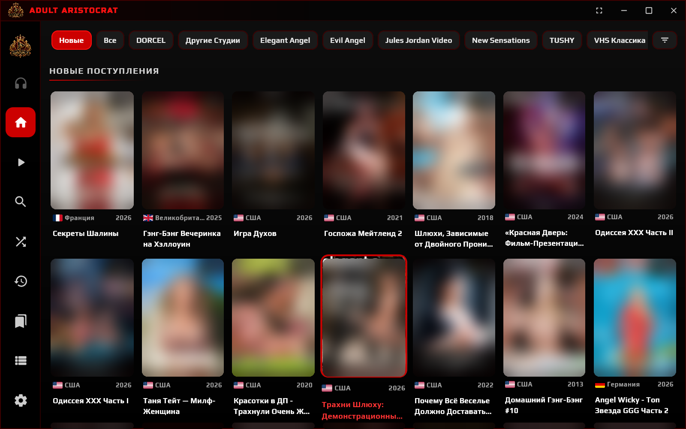
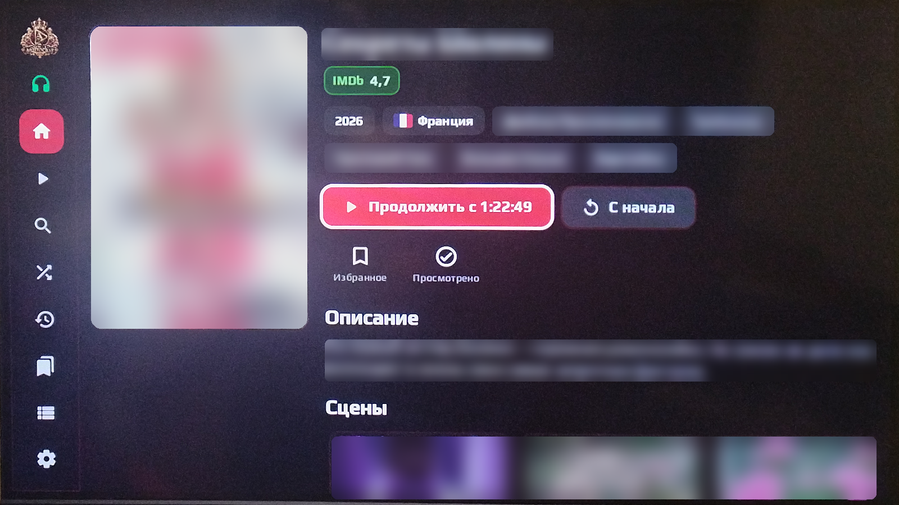

  

<h1 align="center">Adult Aristocrat</h1>

  <b>Ваш личный кинотеатр — на телефоне, телевизоре и компьютере.</b> 
  Красно-чёрный интерфейс в стиле Netflix, сцены, пульт, офлайн-библиотека.

  
  
  
  

---

## 🎬 Как это выглядит

   
  <i>Компьютер: новые поступления, студии и фильтры. Окно без рамки Windows, F11 — во весь экран.</i>

   
  <i>Телевизор: страница фильма — рейтинг, страна, «Продолжить с…», описание и сцены.</i>

> Обложки, названия и описания на скриншотах размыты намеренно.

---

## ✨ Возможности

| | |
|---|---|
| 🏠 **Каталог** | Новые поступления, разделы по студиям, «Все фильмы», случайный фильм, избранное |
| 🔎 **Поиск и фильтры** | Поиск по названию, фильтр по жанрам, годам и странам — в списках только то, что есть в кинотеатре |
| 🎞️ **Страница фильма** | Обложка целиком, рейтинг IMDb, страна с флагом, жанры, описание, актёры, сцены. Нажмите на страну или жанр — откроются все такие фильмы |
| 👤 **Актёры и режиссёры** | Нажмите на фото — откроется биография и все фильмы с этим человеком |
| ▶️ **Сцены** | Переход к любой сцене прямо из плеера или со страницы фильма — без перезапуска |
| 🖥️ **Режимы картинки** | **Вписать / Заполнить / Растянуть** — убирают чёрные полосы, как в VLC |
| ⏯️ **Продолжить просмотр** | Кнопка ▶ в меню сразу продолжает последний недосмотренный фильм |
| ⭐ **Избранное** | Удалить фильм: удержать палец на телефоне, удержать OK на пульте, правая кнопка мыши на ПК |
| 🕘 **История** | Начатые и просмотренные фильмы; кнопка 🗑 очищает историю |
| 🎧 **Наушники** | Кнопка над «Главной»: подключить / отключить Bluetooth. Зелёная — наушники подключены |
| 📺 **Пульт ТВ** | Удобная навигация стрелками, клавиатура открывается только по OK |
| 📶 **Офлайн-библиотека** | Фильмы из сетевых папок дома (SMB) — даже когда сервер недоступен |
| 🔐 **Свой вход** | У каждого зрителя свой логин и своя история |

---

## 📥 Установка

Свежие версии лежат в разделе **Releases** → **latest** (справа на странице репозитория).

| Устройство | Какой файл скачать | Как установить |
|---|---|---|
| 📱 Телефон / планшет Android | `AdultAristocrat-android.apk` | Откройте файл и разрешите установку «из этого источника» |
| 📺 Android TV / приставка | тот же `AdultAristocrat-android.apk` | Скопируйте на флешку или через *Downloader* / *Send Files to TV*, откройте файловым менеджером |
| 🪟 Windows 10 / 11 | `…-win10-11-setup.exe` | Запустите установщик, выберите язык, отметьте ярлыки на рабочем столе и в «Пуске» |
| 🪟 Windows 7 SP1 / 8.1 | `…-win7-setup.exe` | Как выше. Если картинка не появляется — ярлык «программная отрисовка» |
| 🪟 Windows 7 без установки | `…-windows-portable-win7.zip` | Распакуйте и запустите `Start.bat` (или `Start-software.bat`) |
| 🐧 Ubuntu / Debian / Mint | `….deb` | `sudo apt install ./adult-aristocrat_*.deb` |
| 🐧 Fedora / openSUSE | `….rpm` | `sudo dnf install ./adult-aristocrat-*.rpm` |

> **Linux:** для видео нужен VLC — `sudo apt install vlc` или `sudo dnf install vlc`.
> На Windows VLC уже встроен в программу.

Новые версии ставятся **поверх старых** — вход, история и настройки сохраняются.

---

## 🔑 Первый вход

1. Откройте программу — появится экран входа.
2. Введите **логин и пароль**, которые выдал администратор кинотеатра.
3. **Или вход без пароля — Quick Connect:**
   нажмите **«Быстрое подключение»** — на экране появится код.
   Введите его на устройстве, где вы уже вошли:
   **Настройки → Быстрое подключение → Подтвердить**.

> Удобно для телевизора: не нужно набирать пароль пультом.

---

## 📺 Управление пультом и клавиатурой

| Действие | Пульт ТВ | Клавиатура ПК |
|---|---|---|
| Пауза / продолжить | OK, ⏯ | Пробел, K |
| Перемотка ±10 сек | ◀ ▶ | ← → |
| Перемотка ±30 сек | ⏪ ⏩ | — |
| Предыдущая / следующая сцена | ⏮ ⏭, CH− / CH+ | PgUp / PgDn, P / N |
| Список сцен | Menu, Info, 🔴 красная | — |
| Звуковая дорожка | 🟢 зелёная | — |
| Субтитры | 🟡 жёлтая | — |
| Режим картинки (Вписать → Заполнить → Растянуть) | 🔵 синяя | Z |
| Показать панель плеера | ▲ ▼ | мышь |
| Остановить и выйти (позиция сохранится) | ⏹, «Назад» | Esc |
| Во весь экран | — | F11, F |

---

## 📶 Офлайн-библиотека

Если дома есть сетевая папка или NAS с фильмами — приложение может показывать их,
даже когда до сервера нет интернета.

1. **Настройки → Офлайн-библиотека** → включите переключатель.
2. Нажмите **«Найти в сети»** или введите IP-адрес компьютера / NAS.
3. Добавьте папки с фильмами и нажмите **«Сканировать папки»**.

Приложение читает файлы в формате Kodi: `movie.nfo`, `poster.jpg`, `fanart.jpg`,
папку `.actors` с фото актёров, а сцены — прямо из MKV-файлов.

Переключение **онлайн ⇄ офлайн происходит само**, когда пропадает или появляется связь
с сервером (во время просмотра — не переключается). Можно включить **«Всегда офлайн»**.

---

## ❓ Частые вопросы

<b>Видео тормозит или долго запускается</b>

В **Настройках** попробуйте включить «Всегда перекодировать видео» — сервер будет отдавать
облегчённый поток. На мощных устройствах, наоборот, помогает «Прямое воспроизведение файла».

<b>По бокам или сверху чёрные полосы</b>

Нажмите кнопку <b>«Вписать»</b> в плеере (синяя кнопка на пульте, <kbd>Z</kbd> на ПК) и выберите
«Заполнить» — картинка займёт весь экран, края немного обрежутся. «Растянуть» — без обрезки,
но с искажением пропорций.

<b>Не видны сцены у фильма</b>

Сцены — это главы внутри MKV-файла. Если в файле их нет, раздел «Сцены» не показывается.

<b>Windows 7: окно чёрное или программа не открывается</b>

Запустите ярлык <b>«Adult Aristocrat (программная отрисовка)»</b> из меню «Пуск»
или <code>Start-software.bat</code> из portable-версии. Если не помогло — <code>Debug.bat</code>
покажет текст ошибки, пришлите его администратору.

<b>Наушники не подключаются кнопкой 🎧</b>

Сначала один раз соедините наушники в настройках Bluetooth устройства. Дальше кнопка
будет включать Bluetooth и подключать их сама; повторное нажатие — отключает.

<b>Как выйти из аккаунта</b>

<b>Настройки → Выйти из аккаунта</b>. История и избранное хранятся на сервере и вернутся после входа.

---

   
  Adult Aristocrat · частный кинотеатр · 18+ 
  Для разработчика: <a href="docs/BUILD.md">как собрать программу через GitHub</a>

